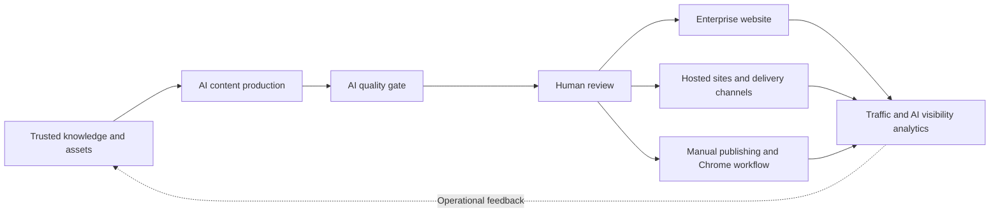

# GEOFlow 3.2.1

> Languages: [简体中文](../../README.md) | [English](README_en.md) | [日本語](README_ja.md) | [Español](README_es.md) | [Русский](README_ru.md) | [Português (BR)](README_pt_BR.md)

## GEOFlow in 60 seconds

See how GEOFlow connects trusted knowledge, AI content production, quality gates, human review, and multi-site publishing in one workflow.

https://github.com/user-attachments/assets/8dbbf34e-e9c1-4139-977a-8e78394e34d9

*60-second video in Chinese*

---

> An open-source GEO operations platform for enterprise websites

GEOFlow connects enterprise knowledge imports, AI articles and topics, library image selection, quality gates, human review, multi-site delivery, and AI visibility analytics in one workflow. Brand, growth, and content teams can run enterprise websites, GEO content channels, industry source sites, or internal content operations while managing sources, content versions, publishing results, and operational data in the same admin system.

[Quick start](#quick-start) · [Interface preview](#interface-preview) · [Core capabilities](#geoflow-321-core-capabilities) · [Deployment guide](../deployment/DEPLOYMENT.md) · [Blue/green deployment](../blue-green-deployment-usage_en.md) · [Changelog](../CHANGELOG_en.md) · [Website](https://www.geoflow.me)

[](../../version.json)
[](https://github.com/yaojingang/GEOFlow/releases/latest)
[](https://www.php.net/)
[](https://github.com/yaojingang/GEOFlow/actions/workflows/ci.yml)
[](../../LICENSE)
[](https://github.com/yaojingang/GEOFlow/stargazers)

> **Version note:** The current source version is stable `3.2.1`. See [`version.json`](../../version.json) for the exact version and [GitHub Releases](https://github.com/yaojingang/GEOFlow/releases) for distribution packages and upgrade notes. The `main` branch continues to receive updates; pin a release tag or a reviewed commit for deployment.

---

## What GEOFlow is built to solve

Enterprise GEO programs need brand knowledge, model configuration, content production, quality review, website engineering, channel delivery, and performance analysis. When these jobs live in separate tools, teams lose the links between source material, review decisions, and published results.

GEOFlow puts the operating workflow in one admin system:



The system records knowledge sources, task settings, model calls, quality evidence, manual overrides, publication state, and channel logs so teams can review and maintain their content assets over time.

---

## Interface preview

<table>
  <tr>
    <td width="50%"><br /><sub>Illustrated help workspace</sub></td>
    <td width="50%"><br /><sub>Analytics overview</sub></td>
  </tr>
  <tr>
    <td width="50%"><br /><sub>Task management</sub></td>
    <td width="50%"><br /><sub>Article AI quality inspection</sub></td>
  </tr>
  <tr>
    <td width="50%"><br /><sub>Hosted channel sites</sub></td>
    <td width="50%"><br /><sub>Manual publishing workspace</sub></td>
  </tr>
</table>

These sanitized screens come from the built-in 3.0 help library and cover knowledge assistance, task scheduling, quality inspection, hosted sites, manual publishing, and analytics.

---

## GEOFlow 3.2.1 core capabilities

| Capability | Current workflow |
|------------|------------------|
| Trusted knowledge and content production | Import TXT, Markdown, DOCX, PDF, and PPTX; manage knowledge, titles, keywords, images, authors, prompts, and models, with vector retrieval, library image selection, and live prompt testing. |
| AI quality gates | Check knowledge evidence, data, citations, advertising rules, and publishing context; retain scores, source locations, suggestions, and history, with automatic optimization, score-based approval, and human review. |
| Topics and ongoing maintenance | Organize existing articles into topics with AI generation, source grouping, review, publication, and scheduled maintenance, using card, reading-guide, or chronological layouts. |
| Review and operations collaboration | Manage drafts, publishing, trash, and bulk exports; platform web channels create manual work orders for Toutiao, Sohu, and NetEase, with Chrome assignment and publication receipts. |
| Enterprise websites and multi-site delivery | Output SEO metadata, Open Graph, Schema, discovery files, and canonical URLs; support theme packages, short videos, hosted sites, GEOFlow Agent, WordPress REST, and generic HTTP APIs. |
| Link pool and recommendation campaigns | Manage internal and health-checked external links for the primary site and first-party hosted sites; select recommendations by category, keyword, and campaign, with output, visibility, and click metrics. |
| AI visibility and operations | Analyze keyword samples, topics, sources, competitors, word clouds, traffic, and AI crawlers; the independent Updater handles signed updates, full backups, environment validation, and restore-point rollback. |
| Team and developer access | Admin UI V3 supports six languages, responsive layouts, PWA, and illustrated help; API v1, CLI, and Agent Skill provide existing content automation, remote theme drafts, and signed previews. |

### Recent updates included in 3.2.1

- Topics and AI topic tasks combine articles with grouping, ordering, bulk creation, review, publication, and scheduled maintenance, with homepage modules, navigation, article backlinks, and Sitemap entries.
- The link pool adds import preflight, recommendation campaigns, site controls, theme adaptation and rollback, and separate output, reader visibility, and click metrics.
- Live prompt testing runs unsaved drafts with knowledge retrieval and title selection, streams generated text, and supports stopping a run and locating AI diagnostic findings in the text.
- Knowledge bases and enterprise knowledge add PDF and PPTX text extraction alongside TXT, Markdown, and DOCX; scans and image-only documents require OCR first.
- Image selection uses library remarks and tags to choose article illustrations, enforces task image limits, and falls back to interval insertion when the model selects none.
- Assisted platform publishing uses manual work orders, the Chrome assistant, and result receipts for Toutiao, Sohu, and NetEase; an operator confirms final publication.
- AI visibility adds topic assignment, source and competitor evidence, word-cloud cleanup, and seven-day successful-sampling markers with manual resampling.
- Themes add featured, personal, and archived library sections and validated short videos; packages default to 3.x compatibility while enforcing explicit minimum versions and feature dependencies.
- Publishing and runtime fixes cover bulk article actions, score-based AI approval, automatic publication, Volcengine multimodal embeddings, opt-in host-based egress proxies, and dependency security updates.

See [Link pool and prompt testing](../operations/link-pool-and-prompt-test.md), [Knowledge imports](../knowledge-import.md), [Assisted platform publishing](../distribution/platform-web-assisted-publishing.md), and [AI visibility](../ai-visibility-operations.md). CLI and Skill retain their own preview versions; [Remote management scope](../api/remote-management-preview.md) describes the current limits on remote theme publication and rollback.

See the [Chinese changelog](../CHANGELOG.md) and [English changelog](../CHANGELOG_en.md) for the complete history.

---

## Where GEOFlow fits

| Scenario | Recommended setup | Main capabilities |
|----------|-------------------|-------------------|
| Enterprise website GEO operations | Build around products, cases, FAQs, industry knowledge, and brand rules | Enterprise knowledge, tasks, quality gates, website publishing, analytics |
| GEO channel within an existing website | Launch an information, knowledge, or solutions channel on a subdomain or separate path | Themes, categories, SEO, scheduling, lead forms |
| Industry source site | Maintain verifiable long-term content for one industry, subject, or problem area | RAG, review, citation-friendly output, sitemaps, `llms.txt` |
| Internal content operations | Keep the public frontend secondary and let brand, growth, and content teams manage production and review | Asset libraries, API, CLI, manual publishing, permissions, audit history |
| Multi-brand or multi-site operations | Manage multiple sites, categories, or publishing destinations from one admin system | Hosted sites, Agent, WordPress, generic APIs, delivery logs |

GEOFlow is designed for teams with real business source material, named review owners, and an ongoing operations plan. Knowledge quality, human judgment, and regular maintenance determine whether users and AI systems can trust the published content.

---

## Security and governance

| Area | Boundary |
|------|----------|
| Content quality | Knowledge evidence, rule versions, scores, manual overrides, and result expiry are traceable. |
| Accounts and permissions | Feature entry points follow permissions, sensitive actions require super-administrator access, and task and manual publishing state changes keep history. |
| Browser operations | The Chrome extension uses device pairing and a least-privilege token. It does not store external platform passwords, cookies, or OAuth credentials. |
| Outbound requests | URL import, delivery, AI, theme references, and update checks share an outbound security policy that limits private-network access, redirects, and response size. |
| Updates and recovery | The Updater uses signed packages, a local Unix socket, environment validation, full backups, and restore points. High-risk requests require a second factor. |
| Anonymous telemetry | Telemetry is disabled by default. When enabled, it sends only allowlisted fields and excludes business content, accounts, email addresses, domains, cookies, and secrets. |

The [deployment guide](../deployment/DEPLOYMENT.md) and the release notes for the selected version define the current security gates and upgrade procedure.

---

## Components and runtime

| Component | Current source version or status | Notes |
|-----------|----------------------------------|-------|
| GEOFlow Core | `3.2.1` | Laravel application, admin, frontend, API, queues, and distribution system |
| GEOFlow CLI | `0.4.0-preview.2` | Bundled as `bin/geoflow`; supports macOS, Linux, and WSL |
| Chrome operations assistant | `0.1.0` | Source and packaged output live in `browser-extension/` and `dist/browser-extension/` |
| GEOFlow Updater | Independent component | Use a signed version explicitly compatible with the target release; see [geoflow-updater](https://github.com/yaojingang/geoflow-updater) |
| Target-site Agent | Generated per channel | Each channel can build a preconfigured PHP package with a homepage, article pages, static assets, Schema, sitemap, and `llms.txt` |

Runtime requirements:

| Component | Requirement |
|-----------|-------------|
| PHP | 8.3 or later; Docker may use PHP 8.4 |
| Database | PostgreSQL; pgvector image or compatible extension recommended |
| Redis | Queues, cache, and runtime state |
| Node.js | Frontend asset builds; CI uses Node.js 22 |
| Container deployment | Docker Compose; production uses Nginx and php-fpm |

---

## Quick start

### Docker for development and evaluation

```bash
git clone https://github.com/yaojingang/GEOFlow.git
cd GEOFlow
cp .env.example .env
docker compose build
docker compose up -d --remove-orphans
```

- Frontend: `http://localhost:18080`
- Admin login: `http://localhost:18080/geo_admin/login`
- `APP_PORT` controls the port, and `ADMIN_BASE_PATH` controls the admin prefix.
- The `init` service runs migrations and initializes an empty database on first start.

The [deployment guide](../deployment/DEPLOYMENT.md) documents development administrator settings. Production environments should set an explicit administrator password, HTTPS, secure cookie policy, and reverse-proxy configuration.

### Docker for production

Production uses `docker-compose.prod.yml` with Nginx and php-fpm. Prepare `.env.prod`, database backups, HTTPS, persistent directories, and process supervision before deployment:

```bash
cp .env.prod.example .env.prod

docker compose --env-file .env.prod -f docker-compose.prod.yml build
docker compose --env-file .env.prod -f docker-compose.prod.yml up -d postgres redis
docker compose --env-file .env.prod -f docker-compose.prod.yml up -d init
docker compose --env-file .env.prod -f docker-compose.prod.yml up -d app web queue ai-quality-queue ai-quality-backfill-queue ai-optimization-queue knowledge-queue scheduler reverb
```

See [`docs/deployment/DEPLOYMENT.md`](../deployment/DEPLOYMENT.md) for production setup, health checks, reverse proxy configuration, and recovery.

For signed managed installation, enrollment, automatic migrations, online or maintenance updates, and recovery, see the [blue/green deployment tutorial](../blue-green-deployment-usage_en.md), also available on the [Wiki](https://github.com/yaojingang/GEOFlow/wiki/Blue-Green-Deployment-and-Automatic-Migrations). Check its release prerequisites before using the new workflow.

### Upgrading from 2.x

See the [3.0 upgrade tutorial (Chinese)](../deployment/GEOFLOW_V3_UPGRADE.md) for deployment-specific steps, backups, data backfills, Updater enrollment, acceptance checks, and recovery. The [documentation center](../README.md) and [Wiki guide](https://github.com/yaojingang/GEOFlow/wiki/v3.0.0-升级教程) link to the same instructions.

Back up the database, `.env`, uploads, and `storage`. Drain old processes before running migrations, rebuilding frontend assets, and restarting services. Early 2.x installations also need the managed-image readiness check and security audit. Enable hosted sites only after wildcard DNS, wildcard TLS, trusted proxies, and Nginx are configured.

Existing deployments should follow the complete [drain and safe migration procedure](../deployment/DEPLOYMENT.md). Avoid rebuilding containers immediately after `git pull`. Exact commands and component compatibility follow the selected GitHub Release.

---

## Developer entry points

### GEOFlow CLI

`bin/geoflow` manages catalogs, tasks, runs, materials, and articles through API v1. It supports secure configuration, login, JSON files or stdin, delete confirmation, and structured errors.

[CLI guide in Chinese](../GEOFLOW_CLI.md) | [CLI guide in English](../GEOFLOW_CLI_en.md)

### GEOFlow Agent Skill

The repository includes a unified [GEOFlow Agent Skill](../../.agents/skills/geoflow/) for Laravel development, admin operations, public frontend work, theme packages, channel sites, and legacy migrations. Tools that support Agent Skills can discover it from the repository, and Codex users can invoke it with `$geoflow`.

See the [Skill README](../../.agents/skills/geoflow/README.md) for installation and rollback instructions.

### Development and tests

```bash
composer install
npm ci
npm run build
composer test
npm run test:analytics
vendor/bin/pint --test
```

Read the [contribution guide](../../CONTRIBUTING.md) before submitting changes.

---

## Open-source and commercial licensing

The current version of GEOFlow is licensed under the [GNU Affero General Public License v3.0](../../LICENSE). Versions previously released under Apache-2.0 keep their original license; the historical text is available at [`docs/licenses/Apache-2.0.txt`](../licenses/Apache-2.0.txt).

**Individuals and businesses can use the open-source edition of GEOFlow free of license fees, including for commercial purposes.** The scenarios below require no separate GEOFlow commercial license when you comply with AGPL-3.0. Internal company use, serving clients, and charging for services do not by themselves require purchasing a commercial license.

| Use case | Licensing terms |
|----------|-----------------|
| Personal learning, research, teaching, evaluation, and testing | Free to use, deploy, and modify |
| Internal company knowledge management, content production, AI quality inspection, and team collaboration | Free to deploy for employees, including in for-profit businesses |
| Operating your own corporate website, brand site, GEO subchannel, or industry reference site | Free to use, including for commercial operations |
| Agencies, studios, or consultants producing content or managing content operations for clients | Free to use; you may charge for content production, consulting, and operational services |
| Providing deployment, training, maintenance, or custom development to clients | Free to use and charge for services; delivering software copies requires compliance with applicable AGPL distribution and source-code obligations |
| Providing hosting or online services (SaaS) based on GEOFlow | Free to use and charge for services; modified versions served over a network must offer interacting users a way to obtain the complete Corresponding Source at no charge |
| Custom development, redistribution, and AGPL-compliant rebranding or OEM delivery | Free to use; retain required notices and comply with applicable same-license and source-code obligations. Trademark rights require separate consideration. |
| Needing an exception to AGPL source-code or other obligations, such as white-label, OEM, or proprietary integrations that require code to remain closed when those obligations apply | Request a separate commercial license from the copyright holder and use the software under the signed agreement |

Before using GEOFlow:

- **Internal company use remains subject to applicable terms.** If employees interact with a modified GEOFlow over a network, AGPL section 13 requires prominently offering them a way to obtain the complete Corresponding Source at no charge. The same requirement applies to modified network services offered to external users. Who must be offered source depends on how the software is used and distributed; the license does not require publishing it in a public GitHub repository, and recipients retain their redistribution rights under the license.
- **Business data and software source code are assessed separately.** Independent knowledge-base materials, client data, and generated articles generally do not need to be disclosed under AGPL merely because GEOFlow was used. Outputs containing covered program code or other covered works must be assessed based on their content.
- **Free refers to software license fees.** Users bear the costs of servers, domains, model API calls, third-party services, and separately purchased technical support.

These examples explain the existing license and add no exceptions. [LICENSE](../../LICENSE) defines the applicable rights and obligations; see [AGPL section 13](https://www.gnu.org/licenses/agpl-3.0.html#section13) and [GNU's explanation of program output](https://www.gnu.org/licenses/gpl-faq.en.html#WhatCaseIsOutputGPL). Seek legal review for complex proprietary integrations or delivery arrangements involving multiple entities.

Start a commercial licensing inquiry through a [GitHub Issue](https://github.com/yaojingang/GEOFlow/issues/new). Issues are public, so do not include contracts, pricing, customer records, or other confidential information. The discussion can move to a private channel after the initial contact. The license text and any signed agreement define the applicable obligations.

External contributors keep copyright in their contributions and must accept the [GEOFlow Contributor License Agreement v1.0](../../CLA.md) before merge. The CLA allows the project to maintain the AGPL edition and offer separate commercial licenses.

### Anonymous telemetry

Anonymous telemetry is disabled by default. When a deployer enables it and configures an HTTPS collection endpoint, an authenticated admin page sends at most one activity event per day. The payload is limited to a random instance ID, an irreversible administrator digest, the GEOFlow version, and the event type.

```dotenv
GEOFLOW_TELEMETRY_ENABLED=false
```

The payload excludes domains, page paths, administrator accounts, email addresses, article content, cookies, `APP_KEY`, and business secrets. No request is sent when the collection endpoint is empty.

---

## Other languages

- [简体中文 README](../../README.md)
- [日本語 README](README_ja.md)
- [Español README](README_es.md)
- [Русский README](README_ru.md)
- [Português (BR) README](README_pt_BR.md)

---

## Star history

[](https://star-history.dera.page/#yaojingang/GEOFlow&Date)
